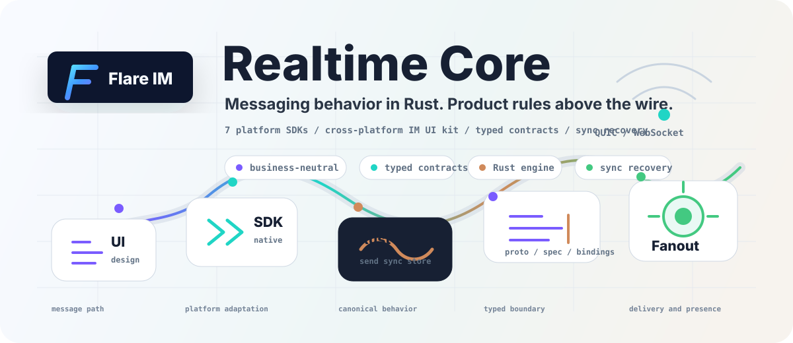

  

<h1 align="center">flare.im</h1>

  <strong>Realtime messaging infrastructure with one Rust behavior core and native SDK surfaces.</strong> 
  一套以 Rust Core 为中心的即时通讯基础设施: 服务端微服务、客户端引擎、七端 SDK、跨端 UI Kit。

  

  <a href="https://github.com/flare-im/flare-transport">Transport</a>
  ·
  <a href="https://github.com/flare-im/flare-core-server">Server</a>
  ·
  <a href="https://github.com/flare-im/flare-core-sdk-engine">Client core</a>
  ·
  <a href="https://github.com/flare-im/flare-core-sdk">SDKs</a>
  ·
  <a href="https://github.com/flare-im/flare-im-design">Design</a>

## Organization Focus

Flare IM is building a reusable instant messaging stack where the realtime behavior is implemented once, tested close to the core, and exposed through platform-native SDKs. Product-specific social features, plugin capabilities, and app choices live above the core instead of leaking into transport or protocol contracts.

The current project is organized around a few firm boundaries:

- **Transport stays reusable**: connection management, QUIC/WebSocket paths, and service discovery live below product semantics.
- **Contracts are explicit**: proto, bindings, and SDK specs define typed boundaries before platform packages adapt them.
- **Client behavior is shared**: send reliability, sync recovery, ordering, storage policy, and lifecycle behavior belong in the Rust client engine.
- **UI remains portable**: design tokens and IM components give the example apps a consistent interface language without making UI rules part of the core.
- **Business layers compose on top**: social, community, enterprise, and plugin features stay outside the business-neutral IM foundation.

## System Map

| Layer | Public Repository | Responsibility |
| --- | --- | --- |
| Wire | [flare-transport](https://github.com/flare-im/flare-transport) | Transport foundations for QUIC/WebSocket connections and service discovery. |
| Contract | [flare-protocol](https://github.com/flare-im/flare-protocol), [flare-protocol-grpc](https://github.com/flare-im/flare-protocol-grpc) | Protocol contracts for DDD/CQRS services and generated integration surfaces. |
| Server | [flare-core-server](https://github.com/flare-im/flare-core-server) | Messaging, session, sync, storage, media, delivery, and fanout services. |
| Server runtime | [flare-server-runtime](https://github.com/flare-im/flare-server-runtime) | Shared server infrastructure used by the Core services. |
| Client core | [flare-core-sdk-engine](https://github.com/flare-im/flare-core-sdk-engine) | Rust client engine for reliable send, sync convergence, ordering, and local state. |
| SDK surface | [flare-core-sdk](https://github.com/flare-im/flare-core-sdk) | TypeScript, Swift, Kotlin, Dart, Flutter, HarmonyOS, and example app packages. |
| Experience | [flare-im-design](https://github.com/flare-im/flare-im-design) | Cross-platform IM UI kit, shared tokens, and native component implementations. |

## Start By Intent

| If You Want To... | Start Here |
| --- | --- |
| Inspect the realtime server path | [flare-core-server](https://github.com/flare-im/flare-core-server) |
| Build against the client SDK contract | [flare-core-sdk](https://github.com/flare-im/flare-core-sdk) |
| Understand the Rust client engine | [flare-core-sdk-engine](https://github.com/flare-im/flare-core-sdk-engine) |
| Reuse the interface language | [flare-im-design](https://github.com/flare-im/flare-im-design) |
| Try a web reference app | [Web example](https://github.com/flare-im/flare-core-examples/tree/main/apps/flare-core-web-app) |
| Try desktop with Tauri | [Tauri example](https://github.com/flare-im/flare-core-examples/tree/main/apps/flare-core-tauri-app) |
| Try mobile foundations | [iOS](https://github.com/flare-im/flare-core-examples/tree/main/apps/flare-core-ios-app), [Android](https://github.com/flare-im/flare-core-examples/tree/main/apps/flare-core-android-app), [Flutter](https://github.com/flare-im/flare-core-examples/tree/main/apps/flare-core-flutter-app) |
| Develop a Flare plugin | [Flare Plugin DevKit](https://github.com/flare-im/flare-plugin-devkit) |
| Browse plugin metadata | [Flare Plugin Catalog](https://github.com/flare-im/flare-plugin-catalog) |

## Engineering Principles

- **Neutral core**: IM infrastructure stays independent from social, community, or enterprise product policy.
- **One behavior source**: shared realtime behavior belongs in the Rust client engine, not in every platform app.
- **Narrow waist**: generated SDK surfaces cross a small, stable runtime boundary instead of duplicating platform logic.
- **Typed contracts first**: protocol and SDK surfaces use explicit fields, enums, and generated contracts.
- **Production paths only**: pre-release work favors one clean implementation path over compatibility shims.
- **Measured realtime quality**: latency, ordering, backpressure, retry, and sync recovery are first-class design concerns.

## Status

Flare IM is under active pre-release development. Public repositories are opened as contracts, SDKs, and examples become stable enough for outside inspection.
