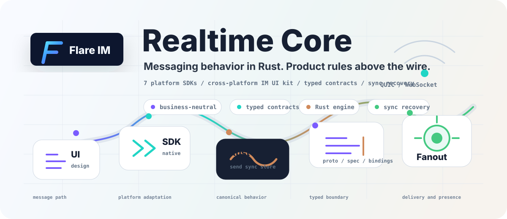

  

<h1 align="center">flare.im</h1>

<a href="https://github.com/flare-im">English</a> · 简体中文

  <strong>实时通信基础设施，由统一的 Rust 核心和多端原生 SDK 组成。</strong> 
  提供服务端微服务、七端 SDK 与跨端 UI 组件库。

  

## 开始开发

- **Core 消息** · [启动公开服务端并完成消息冒烟](https://github.com/flare-im/flare-core-server/blob/main/docs/QUICKSTART.zh-CN.md)，或浏览 [Web、Tauri、Flutter、iOS、Android 参考应用](https://github.com/flare-im/flare-core-examples)。
- **插件开发** · [插件 DevKit](https://github.com/flare-im/flare-plugin-devkit)支持 gRPC 和 WASM，可从 [Echo 示例](https://github.com/flare-im/flare-plugin-devkit/blob/main/flare-plugin-host/examples/echo_plugin.rs)开始。已发布的公开元数据见[插件目录](https://github.com/flare-im/flare-plugin-catalog)。
- **固定版本** · [Core 源码基线](https://github.com/flare-im/.github/blob/main/baselines/README.md)提供可复现的源码检出入口。

## 仓库职责

| 层 | 仓库 | 职责 |
| --- | --- | --- |
| 传输 | [flare-transport](https://github.com/flare-im/flare-transport) | QUIC、WebSocket 连接及服务发现 |
| 契约 | [flare-protocol](https://github.com/flare-im/flare-protocol)、[flare-protocol-grpc](https://github.com/flare-im/flare-protocol-grpc) | 线协议、gRPC 服务及生成绑定 |
| 服务端 | [flare-core-server](https://github.com/flare-im/flare-core-server)、[flare-server-runtime](https://github.com/flare-im/flare-server-runtime) | 消息、会话、同步、存储、媒体、投递及服务端运行时 |
| 客户端 | [flare-core-sdk-engine](https://github.com/flare-im/flare-core-sdk-engine)、[flare-core-sdk](https://github.com/flare-im/flare-core-sdk) | Rust 引擎负责发送、排序、同步和本地状态，各端 SDK 提供原生接入 |
| UI | [flare-im-design](https://github.com/flare-im/flare-im-design) | 设计令牌和跨端 IM 组件 |

Core、UI 组件库和插件开发工具采用开源方式维护。Flare Social 和第一方商业插件实现独立维护，业务策略通过公开契约在 Core 之上组合。项目处于积极开发阶段，公开仓库提供源码、契约和参考应用供集成评估。
